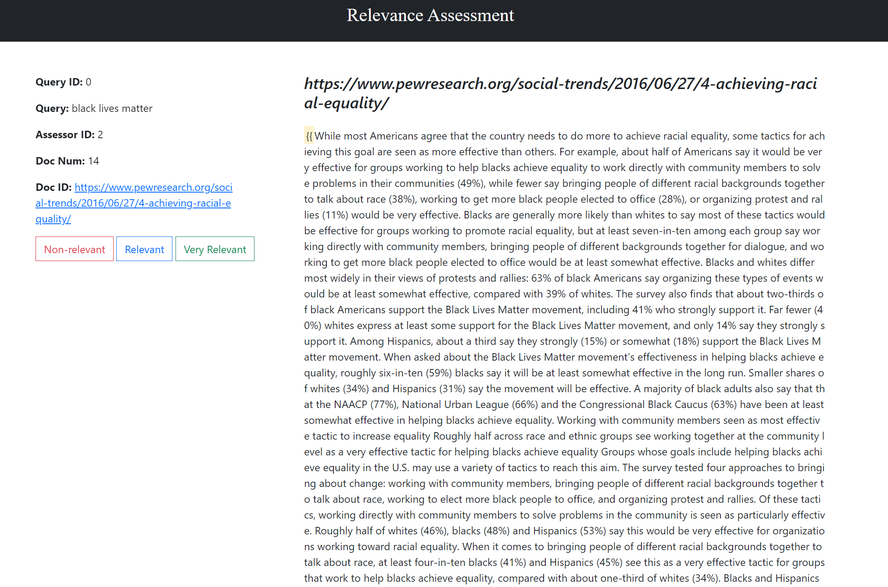

# Vertical Search Engine: Social Justice & Civil Rights

A topic-focused (vertical) search engine built end to end: a polite, multithreaded **focused web crawler**, a **merged Elasticsearch index** shared across a team, **link analysis** (PageRank and HITS) on the crawled web graph, a **web interface for relevance assessment**, and a from-scratch **`trec_eval` reimplementation** for scoring retrieval quality.

Built for CS 4200 *Information Retrieval* at Northeastern University (Spring 2024).

> **Note on AI use:** Claude (an AI assistant) was used only to organize my original homework files into this GitHub project. That meant restructuring the folders, moving credentials into environment variables, small path and cleanup fixes, and writing this README. The search engine itself (crawler, indexing, link analysis, assessment app and evaluator) is my own coursework.



---

## Pipeline

```
 seed URLs ──► Focused crawler ──► Merged team index ──► Link analysis
               (crawler/)          (indexing/)           (link_analysis/)
                  │                     │                 PageRank · HITS
                  │                     ▼
                  │             Assessment web UI ──► QREL files ──► trec_eval
                  │             (assessment/)        (results/)     (evaluation/)
                  ▼
          ~10k documents + inlink/outlink graph
```

| Stage | What it does | Code |
|---|---|---|
| Crawl | Best-first crawl of the topic from 5 seeds, collecting text and the link graph | [`crawler/crawl.py`](crawler/crawl.py) |
| Index | Merges each teammate's crawl into one Elasticsearch index, unioning link sets and authors for shared URLs | [`indexing/merge_index.py`](indexing/merge_index.py) |
| Link analysis | PageRank over the full crawl graph (and the WT2G benchmark graph); HITS hubs/authorities for a query | [`link_analysis/`](link_analysis/) |
| Assessment | Flask app for grading documents per query (0/1/2) with query-term highlighting | [`assessment/app.py`](assessment/app.py) |
| Evaluation | Python reimplementation of `trec_eval`: MAP, R-precision, P/R/F1/nDCG@k | [`evaluation/trec_eval.py`](evaluation/trec_eval.py) |

## Highlights

### Focused crawler
- **Seeds:** Wikipedia's *Social justice* and *Disability rights movement* pages, the ACLU disability-rights page, NCIL, and ADA.gov.
- **Frontier:** a priority queue scored by crawl depth (wave) plus topic-keyword matches in the URL and anchor text. It is **rebalanced** every 100 pages, and at powers of 2 early on, using the inlink counts seen so far.
- **Politeness:** obeys `robots.txt` (cached per host) and waits at least 1 second between requests to the same domain.
- **Filtering:** HTML only (checked with a `HEAD` request), English links only (`hreflang`/`lang`), and skips Wikipedia edit/action URLs and `tel:` links.
- **Canonicalization:** lower-cases the scheme and host, strips default ports, resolves relative URLs, removes fragments and duplicate slashes.
- **Concurrency:** a 100-worker thread pool. It stopped after **10,024 documents** were saved in TREC format, together with their inlink and outlink graph.

### Merged index
Each team member's crawl is bulk-loaded into one shared Elasticsearch index. When a URL already exists, the inlink and outlink sets are unioned and the contributing author is recorded, so the final index has one complete record per page.

### Link analysis
- **PageRank** (d = 0.85) with sink-page redistribution. It runs until the perplexity stabilizes, over both the team's crawl graph and the WT2G benchmark graph.
- **HITS** for the query *"social justice movements"*: a root set of the top 1,000 retrieved pages, expanded to a ~10k-page base set by sampling up to 200 in/out-linked pages per round. Hub and authority scores are L2-normalized each round.

Top PageRank pages in the crawl graph ([full list](results/link_analysis/pagerank_crawl_top500.txt)):

| Rank | Page | Inlinks |
|---|---|---|
| 1 | https://www.unwomen.org/en | 3,817 |
| 2 | https://www.unwomen.org/en/information-security | 2,888 |
| 3 | https://donate.unwomen.org/ | 2,584 |
| 4 | https://www.unwomen.org/en/terms-of-use | 1,792 |
| 5 | https://www.unwomen.org/en/what-we-do/ending-violence-against-women | 1,707 |

Results for HITS [hubs](results/link_analysis/hits_hubs_top500.txt) and [authorities](results/link_analysis/hits_authorities_top500.txt), and for [PageRank on WT2G](results/link_analysis/pagerank_wt2g_top500.txt), are also included.

### Relevance assessment
Four queries: *black lives matter*, *women's rights*, *racial justice* and *disability rights*. Assessors grade a pool of 200 documents per query as **non-relevant (0)**, **relevant (1)** or **very relevant (2)**, and query terms are highlighted in the page text. Grades are appended to a QREL file. [My 800 judgments](results/qrels/QREL_sunkwan.txt) are included.

### Evaluation
`trec_eval.py` reports, per query and averaged:
- the number of documents retrieved, relevant, and relevant-retrieved
- MAP (non-interpolated average precision) and R-precision
- precision, recall, F1 and nDCG at 5, 10, 20, 50 and 100 documents

I checked it against the reference `trec_eval.pl` on a 25-query TREC AP89 run. Both report the same MAP (0.3059), R-precision (0.3350) and P@5/10/20/100 values (0.5200 / 0.4760 / 0.4180 / 0.2556).

---

## Running it

```bash
pip install -r requirements.txt
cp .env.example .env        # then add your Elasticsearch details
```

Run every script **from the repository root** as a module, so the shared `es_client.py` can be imported:

```bash
python -m crawler.crawl                       # crawl -> data/crawl/ (documents + link graph)
python -m indexing.merge_index                # load / merge the crawl into Elasticsearch
python -m link_analysis.pagerank              # PageRank on the indexed crawl graph
python -m link_analysis.pagerank --wt2g path/to/wt2g_inlinks.txt
python -m link_analysis.hits                  # HITS (run pagerank first; it caches the graph)
python -m assessment.app                      # assessment UI at http://localhost:5000
python evaluation/trec_eval.py [-q] <qrel_file> <trec_run_file>
```

Elasticsearch connection settings are read from `.env`. Set `ES_CLOUD_ID`/`ES_PASSWORD` for Elastic Cloud, or `ES_HOST` for a local cluster.

> **Note:** The full crawl (several GB of documents and pickled link graphs) is not included in this repository. [`results/sample_crawl_documents.txt`](results/sample_crawl_documents.txt) shows the stored document format. The crawl takes many hours because of the politeness delay, and the live web has changed since 2024, so a rerun will not reproduce the original collection exactly.

## Repository layout

```
├── crawler/crawl.py            focused web crawler
├── indexing/merge_index.py     merge crawl into the shared ES index
├── link_analysis/
│   ├── pagerank.py             PageRank (crawl graph or WT2G)
│   └── hits.py                 HITS hubs & authorities
├── assessment/
│   ├── app.py                  Flask relevance-assessment app
│   ├── documents.txt           assessment pool (200 docs x 4 queries)
│   └── templates/              Bootstrap UI
├── evaluation/trec_eval.py     trec_eval reimplementation
├── es_client.py                shared Elasticsearch connection (env-based)
├── results/                    PageRank/HITS rankings, QRELs, sample docs
└── docs/
    ├── reports/                original write-ups (crawling, link analysis, evaluation)
    └── images/
```

## Known limitations
- **nDCG** in `trec_eval.py` uses the cumulative count of relevant documents instead of the discounted gain, so the values can go above 1. The other metrics match the reference implementation.
- The crawler's `content-language` header check has a typo (`content-langauge`), so language filtering depends only on the link attributes.
- PageRank scores on the crawl graph are not normalized to sum to 1. The ranking order is still meaningful, but the raw values are not.

## Acknowledgements
This was a team project in CS 4200 at Northeastern University. Each member crawled part of the topic, and we merged our crawls into one shared index and pooled our relevance judgments. This repository contains my own components: the crawler, the merge script, link analysis, the assessment app and the evaluator.
